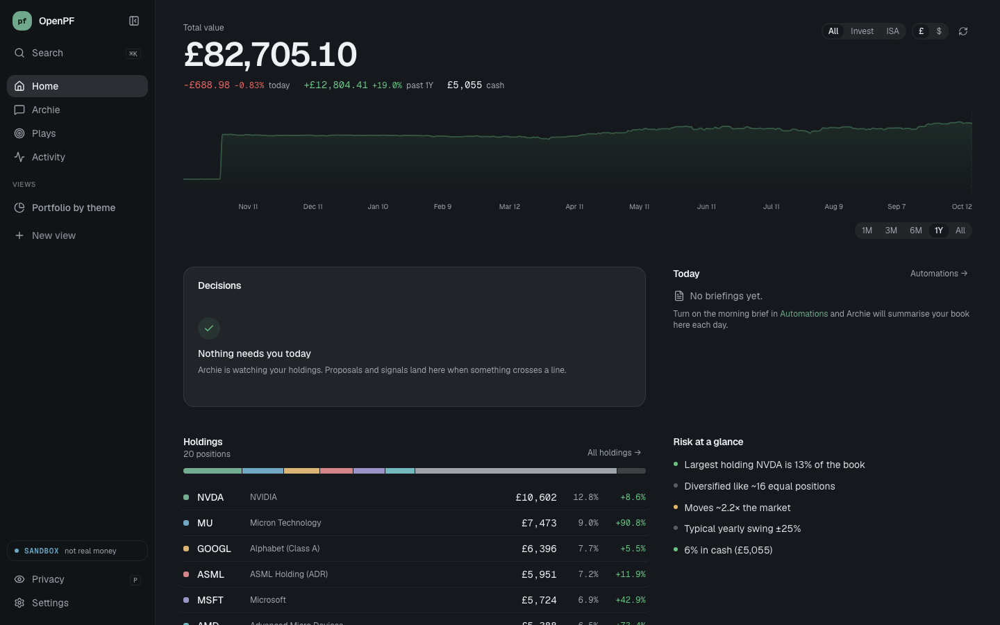
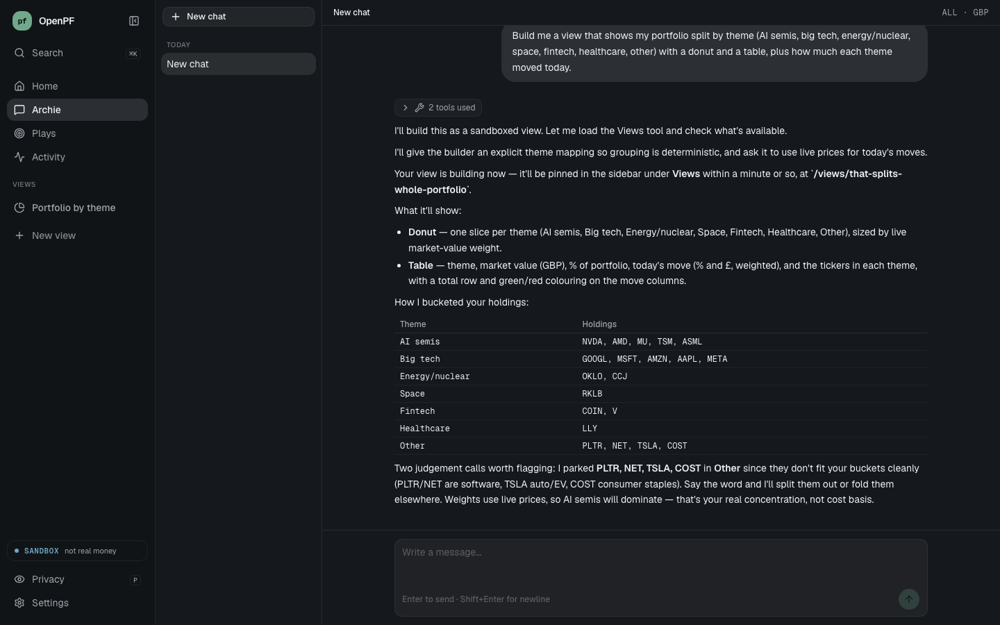
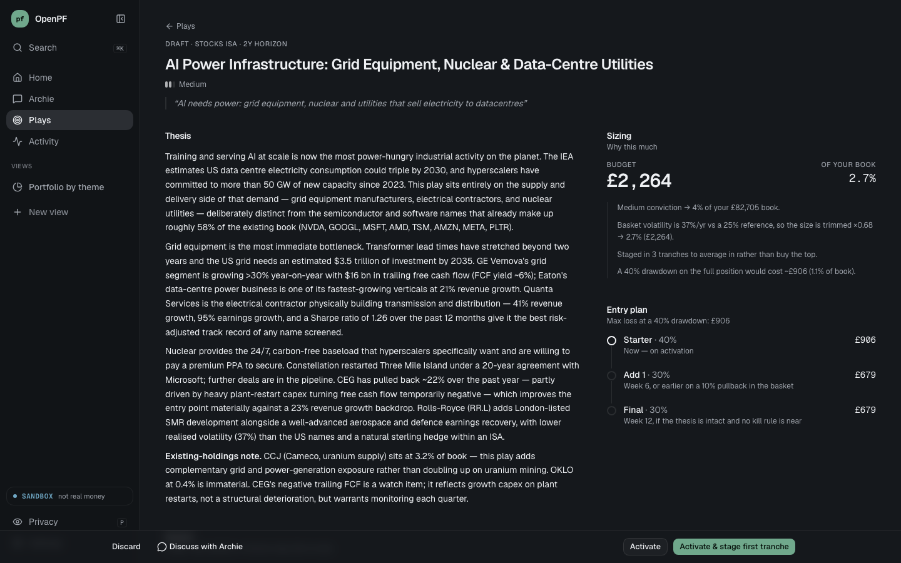
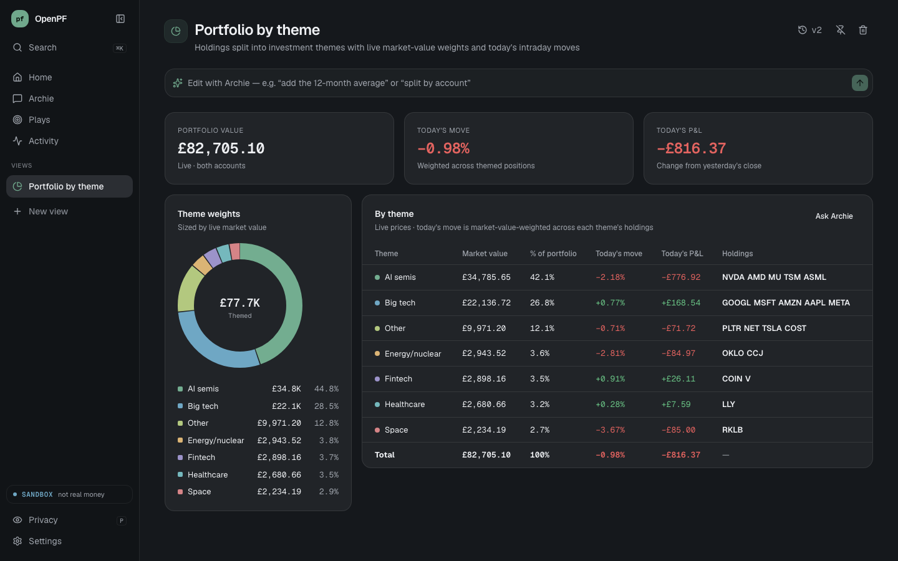

# OpenPF

**An open-source AI agent for your Trading 212 portfolio — on a leash.**

Archie (built on Claude) reads your Invest and Stocks ISA accounts, tells you how to put idle cash to work, sizes bets on the themes you believe in, reacts to the news that matters to *your* holdings, and builds you any view of your money you ask for. It can never trade on its own: every order is a proposal you approve.

Self-hosted. Your keys, your data, your machine.



## Try it in a minute — no broker account needed

```bash
git clone https://github.com/joshuaramkissoon/openpf && cd openpf
make demo            # or ./scripts/demo.sh
```

Open http://localhost:5173. The demo runs against a **sandbox broker**: a built-in mock of the Trading 212 API with a realistic two-account portfolio, priced with real market data. Approve a trade and it fills against the mock. Nothing touches a real account.

Archie uses your Claude login (the `claude` CLI) or `ANTHROPIC_API_KEY`.

## What it does

**Home: what's my money doing, and what needs me?** One number, one chart, and a short list of decisions: proposals to approve and signals worth a look, deduplicated and capped so they don't pile up.

**Archie.** Ask anything about your portfolio. "How should I deploy my £5k idle cash?" gets you specific, sized, per-account proposals that respect your risk rails. Each one lands in Decisions for a one-tap approve.



**Plays: sized bets on themes.** Tell it what you believe ("AI needs power", "the nuclear renaissance"). Archie researches a basket, then sizes it against your actual book:
- Conviction × volatility sets the total, capped as a share of your portfolio.
- Overlap with what you already hold counts towards the target.
- Entry is staged in tranches.
- Kill criteria are machine-checkable and checked daily.

Staging a tranche creates proposals. Nothing executes without you.



**Views: the app builds itself into what you want.** "Show me my portfolio split by theme with today's move." In about a minute there's a new page pinned in your sidebar, running live on your data. Edit it with a sentence and revert to any version. Views run in a locked-down sandbox: they can read a whitelisted set of portfolio data and nothing else. No network, no trading, no access to the app.



**Automations.** A morning brief, a weekly review, and watchlist and earnings monitors run on a schedule. Results land on Home and, optionally, in Telegram.

## Safety model

OpenPF is built so that a confused or prompt-injected agent cannot move your money.

- **Archie can only propose.** Its broker tools are read-only. To act, it calls `propose_trade`, which checks your risk rails and queues a proposal.
- **One execution gate, enforced in code.** Orders reach the broker only through `execute_intent`, and only for proposals a human approved. It re-checks every rail: per-order and daily notional caps, duplicate window and cash.
- **Execution keys never enter an agent process.** Trading 212 lets you create separate read and trade keys. Only the API server holds the trade key. Agent hooks also block calls to the app's own API and to trading212.com.
- **Safe defaults.**
  - New installs run in paper mode on T212's demo environment.
  - The server binds to localhost.
  - `OPENPF_API_TOKEN` locks the API when you expose it on your LAN or Tailscale.
  - Telegram ignores everyone not on your allowlist.
- **Leveraged desk (labs, off by default):** an optional regime-aware 3× ETP engine. It only places orders itself if you switch on auto-execute, and always within its own hard daily rails. Agents can tighten those rails, never loosen them.

## Connect your Trading 212 account

1. In Trading 212: Settings → API → generate a key for each account (Invest, Stocks ISA). Make one **read** key and, if you want to approve trades from OpenPF, a separate **trade** key (ideally IP-restricted).
2. Set up and run:

   ```bash
   cd backend && cp .env.example .env    # add ANTHROPIC_API_KEY (or use your claude login)
   python3 -m venv ../.venv && ../.venv/bin/pip install -r requirements.txt
   ../.venv/bin/uvicorn app.main:app --port 8000
   # second terminal
   cd frontend && npm install && npm run dev
   ```

3. Open http://localhost:5173 → Settings → Broker, paste your keys, and pick paper or live.

Keep it running on an always-on machine with `./scripts/serve.sh` (see `docs/running-on-mac-mini.md`), or use Docker with `make up`.

| Variable | Purpose |
|---|---|
| `ANTHROPIC_API_KEY` | Claude access (optional if you're logged in with the `claude` CLI) |
| `BROKER_MODE` | `paper` (default) or `live`; Settings → Broker overrides it once saved |
| `T212_BASE_ENV` | `demo` (default), `live`, or `sandbox` |
| `OPENPF_SANDBOX` | `1` = use the built-in mock broker; real broker keys are ignored, and the DB, Archie's runtime (artifacts + memory) and views default to `.demo/`. The app refuses to start if pointed at the live instance's data |
| `OPENPF_RUNTIME_DIR` | Archie's per-instance folder (working dir, `artifacts/`, `memory/`). Default `.claude/runtime` |
| `CORS_ORIGINS` | Extra origins allowed to call the API. State-changing requests from other sites are refused |
| `OPENPF_API_TOKEN` | Require a token for the API and chat (set it before exposing beyond localhost) |
| `OPENPF_USER_NAME` | How Archie addresses you |
| `VIEWS_MODEL` / `CLAUDE_PLAYS_MODEL` | Models for the view builder and play drafting |

## How it's built

```
frontend/  React + Vite + Tailwind + shadcn
  src/app/            shell, routing, data hooks
  src/features/       home · plays · views (agent-built pages + sandbox runtime)
backend/   FastAPI + SQLite + APScheduler + Claude Agent SDK
  app/services/       portfolio, proposals + execution gate, plays, views builder, scheduler
  app/services/sandbox_broker.py   mock Trading 212 for demos and development
  mcp_servers/        Archie's tools: trading212 (read-only), marketdata, fundamentals,
                      proposals, plays, views, scheduler, watchlist, …
.claude/runtime/      Archie's identity, skills and (gitignored) memory
```

Run the tests with `cd backend && ../.venv/bin/python -m pytest -q`. The frontend builds with `cd frontend && npm run build`.

## Status

This is a personal project, released because the pattern seemed worth sharing: an agent that operates a real brokerage account behind a hard approval gate, and an app that grows the views you ask for. Expect rough edges. Issues and PRs welcome.

## Disclaimer

OpenPF is software for managing your own account. It is not financial advice, and nothing it says is a recommendation. You are responsible for every trade you approve. Trading 212's API is in beta and may change.

## License

MIT
