# OpenPF

**A self-hosted portfolio app with an AI analyst that proposes trades and never places one without you.**

OpenPF puts your Trading 212 accounts, crypto exchanges and other brokers in one book. Archie, an agent built on the Claude Agent SDK, researches, sizes and explains. Every order it suggests waits for your approval at a single gate in the code.

Your keys, your data, your machine. MIT licensed.

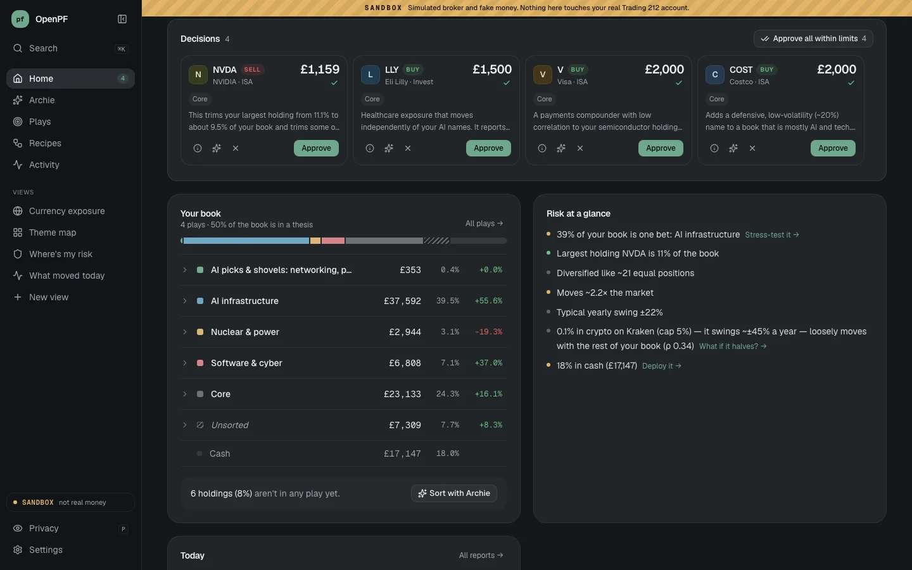

<sub>Screenshots are from sandbox mode: a mock broker with fake money.</sub>

## What it does

| | |
|---|---|
| **Home.** Your whole book in one number and one chart. Holdings are grouped by play, risk is summarised in plain English, and the trades that need you sit in **Decisions**. | **Archie.** Ask about your money in plain English. It reads your accounts, runs the numbers and charts them inline. When it suggests a trade, it shows a sized proposal card for you to approve. |
| 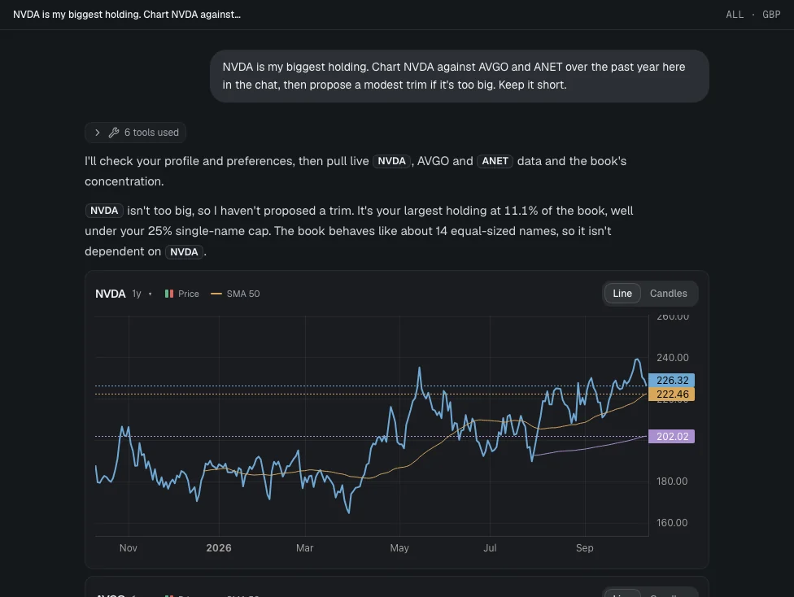 | 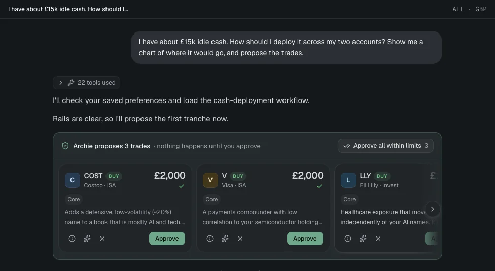 |
| **Plays.** Sized bets on a theme: write what you believe, or start from a template. Archie picks a basket and sizes it against your book: conviction × volatility, capped as a share of your portfolio, staged in tranches, with kill rules that are checked daily. | **Every play has a page** with its value against target, its kill rules, and each holding against its target weight. You can rebalance it with one click, which creates proposals for you to approve. |
| 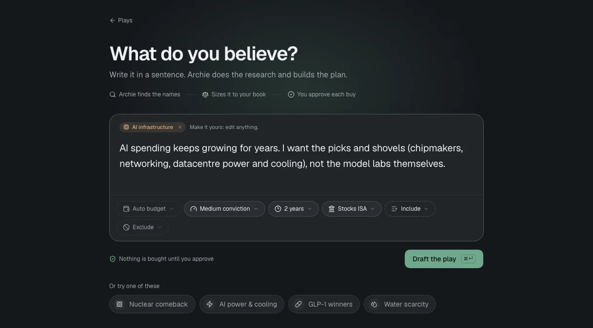 | 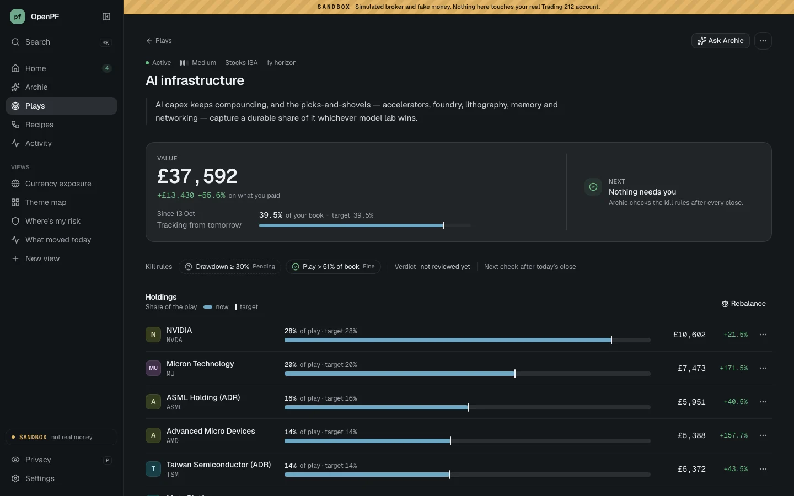 |
| **Views.** Pages built from a sentence, such as "where's my risk?" or "my book by theme". They're pinned in the sidebar and run live on your data. A view is a declarative spec, not code: it reads whitelisted portfolio data and can't trade or reach the network. | **Stock sheet.** Open any instrument for its price against your average cost, its weight against your cap, how much of your risk it carries, what it moves with, news and fundamentals. |
| 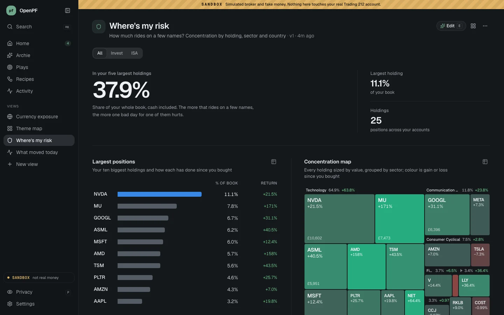 | 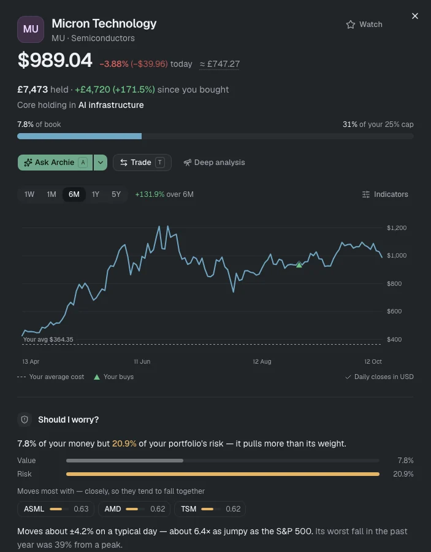 |
| **Trade it yourself.** Every order gets a review step showing amount, account, fees, your weight after the trade, and a check against your limits before anything is sent. | **Recipes.** Routines Archie runs on a schedule or when something happens, such as a morning brief, a play check-in or a big-move explainer. Refine one with a sentence. Recipes can propose trades, never place them. |
| 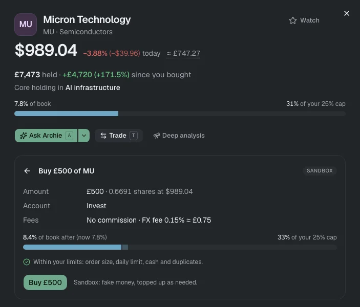 | 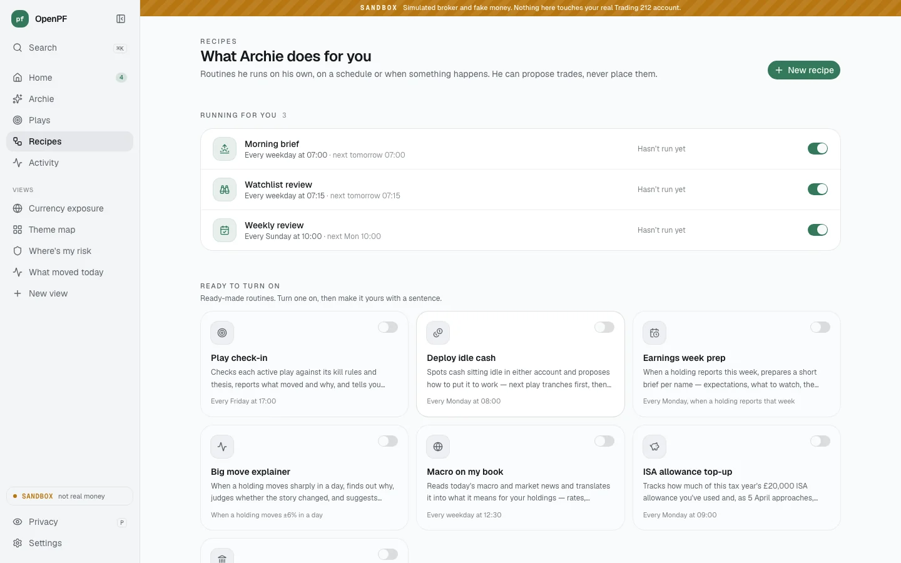 |

**Connections.** Trading 212, Kraken, Coinbase, Binance, Interactive Brokers, Alpaca, and many brokers without a public API through SnapTrade (read-only; check SnapTrade's current broker list). Each account starts read-only, and every account feeds the same book.

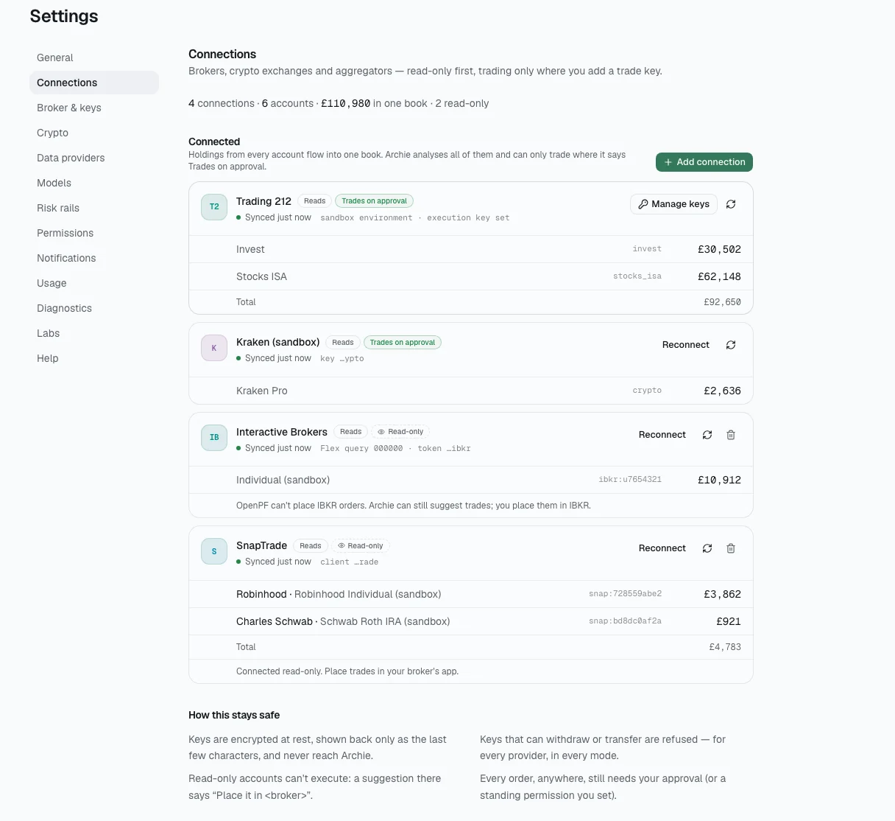

## Safety model

OpenPF is built so that a confused or prompt-injected agent can't move your money.

- **Archie only proposes.** Its broker tools are read-only. To act, it calls `propose_trade`, which checks your limits and queues a proposal.
- **One execution gate.** Orders reach a broker only through `execute_intent`, and only for approved proposals. The gate re-checks every limit at execution time: per-order and daily caps, the crypto cap, the duplicate window and available cash.
- **Limits hold proposals back.** A suggestion over a limit becomes a held-back card, not an order.

  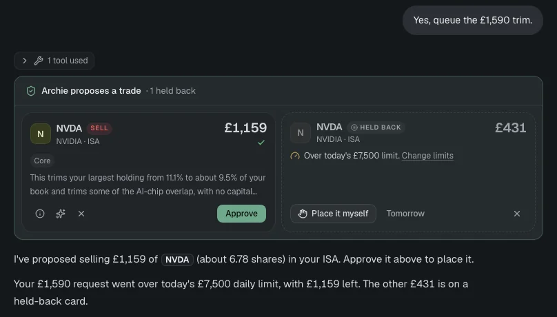

- **Standing permissions are opt-in.** In Settings → Safety you can let a narrow category of trade go through without a tap, for example the next tranche of a play you already approved. Each permission has a per-trade cap, a daily cap, an optional expiry and an off switch. No agent tool can create or widen one.
- **Read-only connections can't execute.** Archie's suggestions for those accounts say "Place it in <broker>", and the gate refuses them.
- **Keys never reach the agent.** Trade keys live only in the API server. Connection secrets are encrypted at rest, and crypto keys that can withdraw or transfer are refused when you connect them. Provider credentials are scrubbed from every agent process, and agent hooks block the brokers' and exchanges' API hosts as well as the app's own API.
- **Safe defaults.** New installs use paper mode on Trading 212's demo environment, and the server binds to localhost. `OPENPF_API_TOKEN` locks the API if you expose it.
- **An honest track record.** Every proposal, including the ones you rejected, is scored against a benchmark at 1 day, 1 week, 1 month and 3 months (Activity → Track record).
- **Sandbox mode.** `OPENPF_SANDBOX=1` swaps in a mock broker and mock exchanges. Real keys are ignored, the real clients refuse to start, and the app refuses to run against a live install's data.

## Quick start

### 1. Try the demo (sandbox, no broker account)

Requirements: Python 3.12, Node 20+, and access to Claude (see [Configuration](#configuration)).

```bash
git clone https://github.com/joshuaramkissoon/openpf && cd openpf
make demo            # same as ./scripts/demo.sh
```

Open http://localhost:5173. The demo creates `.venv`, installs dependencies on first run, and starts the API on `:8010` against a mock Trading 212 holding a two-account portfolio priced with real market data. Approved trades fill against the mock. Demo data lives in `.demo/`, and `./scripts/demo.sh --reset` starts again from a fresh portfolio.

### 2. Connect your real accounts

```bash
cp backend/.env.example backend/.env       # add your Claude credentials (see below)
python3 -m venv .venv && .venv/bin/pip install -r backend/requirements.txt
(cd backend && ../.venv/bin/uvicorn app.main:app --port 8000)
# in a second terminal
cd frontend && npm install && npm run dev
```

Open http://localhost:5173 → **Settings → Accounts** and add your accounts. For Trading 212, create a **read** key per account (Invest, Stocks ISA) in the T212 app under Settings → API. If you want to approve trades from OpenPF, also create a separate IP-restricted **trade** key. Each provider has an in-app guide listing the permissions to tick.

The app starts in paper mode on T212's demo environment. Switch to live in Settings → Safety once you're happy.

**Always-on:** `./scripts/serve.sh` runs the API and dashboard in the background (see [docs/running-on-mac-mini.md](docs/running-on-mac-mini.md)), or use Docker with `make up`, which also runs the scheduler worker. If you run it without Docker, set `INPROC_SCHEDULER_ENABLED=true` so that recipes run.

## Configuration

Settings go in `backend/.env` (template: [`backend/.env.example`](backend/.env.example)). Most can also be changed in the app.

**Claude access (required for Archie).** Archie runs on the Claude Agent SDK, which bundles the Claude Code CLI. OpenPF uses the first of these it finds:

1. `CLAUDE_CODE_OAUTH_TOKEN`: a token from `claude setup-token`, billed to your Claude plan. When it's set, `ANTHROPIC_API_KEY` isn't passed to the agent.
2. `ANTHROPIC_API_KEY`: a pay-as-you-go key from the Anthropic Console.
3. Neither: the CLI's existing login on the machine (`claude login`).

| Variable | Purpose |
|---|---|
| `TOGETHER_API_KEY` | Optional. Builds views in seconds with a fast open model on Together AI. Without it, views use Claude; with neither, you get the closest preset. Also settable in Settings → Data providers. |
| `SEC_CONTACT_EMAIL` | Optional. Enables smart money (insider Form 4 and 13F filings): the SEC requires a contact email in the User-Agent. |
| `OPENPF_API_TOKEN` | Requires a token on the API and chat. Set it before exposing OpenPF beyond localhost. |
| `OPENPF_USER_NAME` | Optional. The name Archie addresses you by. |
| `BROKER_MODE` / `T212_BASE_ENV` | `paper` (default) or `live` / `demo` (default), `live` or `sandbox`. Settings → Accounts (Trading 212) overrides them once saved. |
| `MAX_SINGLE_ORDER_NOTIONAL`, `MAX_DAILY_NOTIONAL`, `MAX_POSITION_WEIGHT`, `MAX_CRYPTO_PCT_OF_BOOK` | Default limits. Settings → Safety overrides them. |
| `OPENPF_SANDBOX` | `1` = mock broker and exchanges. Real keys are ignored, and the DB, views and Archie's runtime default to `.demo/`. |
| `OPENPF_SECRETS_KEY` | Optional Fernet key for connection secrets. By default it's `openpf-secrets.key`, stored next to the database. Back it up with the DB. |

## Supported connections

| Provider | What you paste | Read | Trade |
|---|---|---|---|
| Trading 212 (Invest, Stocks ISA) | a read key, plus an optional IP-restricted trade key | ✓ | ✓ on approval |
| Kraken, Coinbase Advanced Trade, Binance | a query-only key, later a trade-only key (keys that can withdraw are refused) | ✓ | ✓ on approval |
| Interactive Brokers | a Flex Web Service token + Flex Query ID | ✓ | you place it in IBKR |
| Alpaca | a key ID + secret (live or paper) | ✓ | you place it in Alpaca |
| SnapTrade → Robinhood, Schwab, Fidelity, Vanguard, … | a free SnapTrade Personal key, then a broker login on SnapTrade's page | ✓ | you place it in your broker |

Holdings are converted to GBP (or USD) and tagged by account. Details, sources and the per-provider safety checks are in [docs/connections.md](docs/connections.md).

## Architecture

```
frontend/   React + Vite + Tailwind
backend/    FastAPI + SQLite + APScheduler + Claude Agent SDK
  app/services/   portfolio, proposals + execution gate, plays, views, recipes, connections
  app/quant/      sizing, risk and rebalance maths (Archie's quant tools)
  mcp_servers/    Archie's tools: trading212 (read-only), marketdata, fundamentals,
                  proposals, plays, views, recipes, quant, smart money, crypto, …
.claude/runtime/  Archie's identity and skills (its memory is gitignored)
```

More detail: [docs/archie-toolkit.md](docs/archie-toolkit.md) (Archie's tools) and [docs/connections.md](docs/connections.md).

## Contributing

Issues and PRs are welcome. Before opening a PR:

```bash
cd backend && ../.venv/bin/python -m pytest -q
cd frontend && npm run build
```

Develop against the sandbox (`make demo`) so that nothing touches a real account.

## License

[MIT](LICENSE)

## Disclaimer

OpenPF is software for managing your own accounts. It is not financial advice, and nothing Archie says is a recommendation. Use it at your own risk: you are responsible for every trade you approve. Broker and exchange APIs (including Trading 212's beta API) can change or fail. Start in sandbox or paper mode.
